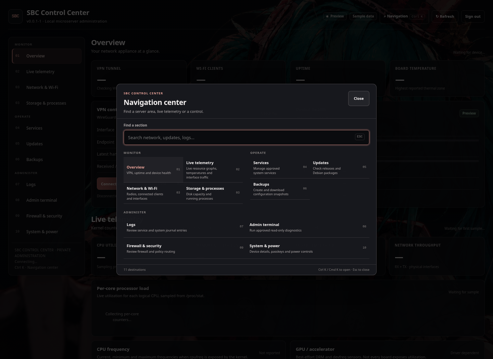
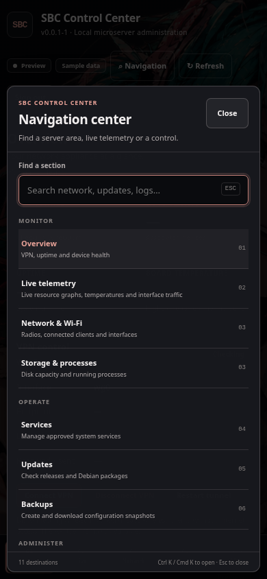
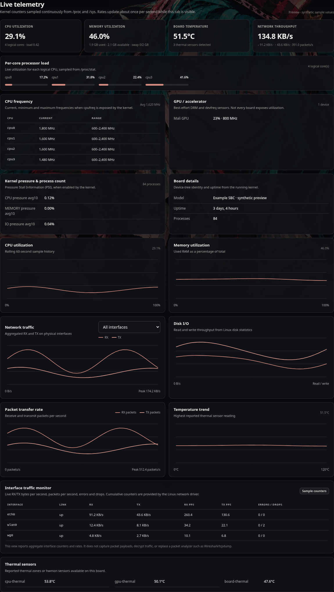
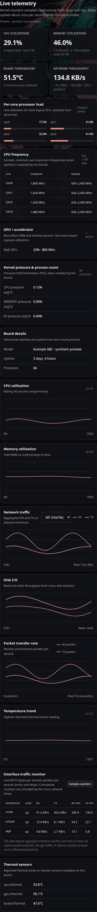

# SBC Control Center

**Version:** `0.0.1-2`  
**Project:** [0xb0rn3/sbc-control-center](https://github.com/0xb0rn3/sbc-control-center)

SBC Control Center is a self-hosted web interface for monitoring and administering a small Linux microserver. It combines host telemetry, network status, service controls, a restricted diagnostic console, update checks, configuration backups and passkey-capable authentication in a responsive desktop/mobile interface.

> **Hardware validation:** the current project has been tested so far on the **KickPi K2B** running an Armbian/Debian 13 (Trixie)-based system. Other single-board computers and microservers have not yet been validated. Treat support for other hardware as experimental until tested and documented.









## Features in 0.0.1-2

- Security patch: hardened root-agent isolation, fail-closed PAM root-bypass detection, bounded privileged socket workers, one-second non-overlapping telemetry scheduling, and controlled transient apt execution.

- Responsive administration portal with desktop sidebar, searchable navigation center and compact mobile navigation.
- Live telemetry samples Linux `/proc` and `/sys` on a non-overlapping one-second schedule while the browser tab is visible (browser scheduling and request latency mean this is a target, not a hard real-time guarantee): total/per-core CPU utilization, available CPU frequencies, RAM and swap, board thermal sensors, disk read/write throughput, process count, load average, kernel PSI pressure, and per-interface RX/TX bytes/s, packets/s, errors and drops. It also reports GPU/NPU frequency or utilization when the board's DRM/devfreq driver exports those metrics. Desktop and mobile trend charts keep a rolling 60-second sample window and can be filtered by interface. The network view provides Wireshark-style traffic-rate visibility from kernel counters; it does not capture packet payloads, decode protocols or replace Wireshark/tcpdump.
- Two-radio `hostapd` access-point view and configuration workflow for the current tested router-style profile.
- Service status and explicitly allow-listed start/stop/restart operations.
- WireGuard tunnel status and allow-listed service controls.
- Admin diagnostic console with fixed argument arrays, bounded output and read-only commands. Root-only diagnostics request a fresh Linux sudo password. It is **not** an unrestricted shell.
- Debian package update checks and an optional GitHub Releases metadata checker. Release checks do not execute or install remote project code.
- Password login, TOTP support and WebAuthn passkey login. HTTPS is enforced: the application starts only with a valid certificate/key, serves TLS 1.2 or newer, has no plaintext HTTP listener, and sends HSTS on HTTPS responses. Passkeys require a trusted HTTPS origin and a stable DNS hostname.
- Timestamped configuration snapshots. Creating or downloading a backup, which can contain Wi-Fi credentials, requires fresh sudo-password verification.
- Dark, low-glare design with the project background artwork applied across the interface.

## Current platform and scope

The codebase currently targets a Debian-family Linux host and the network layout used in the KickPi K2B validation setup. Telemetry is best-effort: temperature, CPU frequency, GPU/NPU utilization and PSI are shown only when the board kernel and drivers export the relevant `/sys` or `/proc` interfaces. Missing hardware/driver interfaces are shown as unavailable rather than estimated. In particular, the network-management pages expect a two-radio access-point profile using:

- `hostapd` and its primary/secondary configuration files;
- `dnsmasq` lease information;
- an `nftables` table named `inet apguard` and the matching AP firewall/service conventions;
- a `wg-quick@<interface>` WireGuard service.

The installer detects existing `hostapd` interface/SSID settings and an existing WireGuard profile where possible. It exposes environment overrides for hardware and network-specific values. Monitoring functions based on Linux `/proc`, `/sys`, `ip`, `ss` and standard system tools may work on other SBCs, but that is not a claim of full cross-platform support.

**Do not run the installer on a production machine until you have reviewed `install.sh`, the network assumptions above and your existing firewall.** The installer may add an HTTPS portal allow rule to `/etc/apguard.nft` when that file exists. It does not provision a complete AP, DHCP, VPN or kill-switch configuration from scratch.

## Requirements

- Debian 13 / Trixie is the currently targeted OS. Other Debian-derived distributions are unverified.
- Python 3, systemd and root access for installation.
- `hostapd`, `dnsmasq`, `nftables`, `iproute2`, `iw`, WireGuard and the corresponding service/configuration files for the network-management features.
- `python3-fido2` for passkey functionality (installed by the installer on supported Debian repositories).
- A local DNS/mDNS name and a trusted HTTPS certificate for passkey use.

## Install

Clone the public repository and review the scripts before running them:

```bash
git clone https://github.com/0xb0rn3/sbc-control-center.git
cd sbc-control-center
less install.sh
less agent.py
less web.py
```

The installer uses existing `hostapd` and WireGuard configuration to detect interfaces and tunnel names where possible. Override the profile with environment variables when required:

```bash
sudo env \
  AP_IFACE=wlan1 \
  AP2_IFACE=wlan0 \
  AP_IP=10.50.0.1 \
  AP_SUBNET=10.50.0.0/24 \
  AP2_IP=10.60.0.1 \
  AP2_SUBNET=10.60.0.0/24 \
  VPN_INTERFACE=wg0 \
  PORTAL_HOSTNAME=sbc-control-center.local \
  bash install.sh
```

The values shown are example defaults, not detected facts about your network. Choose free subnets that do not overlap with your LAN/VPN and check the interface names before installing. The installer creates the portal administrator account and prompts you to set its password. Keep TCP/8443 on your trusted LAN; do not forward it from the public internet.

Open the portal at:

```text
https://sbc-control-center.local:8443
```

The installer creates a local self-signed certificate. Browsers must trust that certificate (or you must deploy a certificate from your local CA) to avoid browser warnings and enable passkeys. The hostname must resolve to the server's address. Passkeys are origin-bound and do not work when switching between hostnames and IP addresses. The portal deliberately does not expose an HTTP port or redirect: use the HTTPS URL directly.

## Authentication and passkeys

The portal supports administrator password login, optional TOTP and WebAuthn passkeys. Passkey enrollment/removal requires fresh administrator verification and TOTP when enabled. The server stores public credential material only; private keys remain in the platform authenticator or external security key. Challenges are short-lived and single-use, and credential storage is permission-restricted.

Set `PORTAL_HOSTNAME` at install time to the stable DNS name you will use from every device. Do not change the hostname after enrolling passkeys unless you intend to re-enroll them. Retain the password/TOTP recovery method.

## Updates

The Debian package update workflow is separate from the Control Center's GitHub release checker. To enable six-hour metadata checks, open **Updates** and set the release source to:

```text
0xb0rn3/sbc-control-center
```

The project should publish GitHub Releases with numeric version tags such as `v0.0.1-1` or `v0.0.2`. Numeric revision suffixes are compared as revisions. The checker retrieves release metadata only. It does not download, execute or install code. Review a release and update manually over SSH after verifying its contents.

## Privilege model and security audit notes

- The HTTPS web process runs as the dedicated `sbc-control-center` system account. If `web.py` is accidentally launched as root, it drops supplementary groups, GID and UID to that account before binding the listener. Launching it as an unrelated unprivileged account or with unexpected supplementary groups is rejected.
- The root-side local agent accepts Unix-socket requests only from the `sbc-control-center` UID using Linux `SO_PEERCRED`. It does not accept the root UID as a portal peer.
- Mutating/root-only actions, package operations, service management, Wi-Fi changes, reboot/shutdown, release-source changes, system journal reads, firewall-rule inspection, WireGuard console details and sensitive backup downloads require a fresh password check against the host PAM `sudo` policy. The check does not trust cached sudo timestamps or `NOPASSWD` rules. A short-lived, session-bound, single-use token is stored as a hash in memory, bound to the exact action and target, and expires after 120 seconds; failed checks are rate-limited by session and configured admin account.
- The privileged agent uses fixed executable paths, fixed argument arrays and allow-lists. No HTTP input is passed to a shell, `eval`, or an arbitrary command executor. The terminal remains restricted and read-only. Automatic dashboard polling does not run privileged firewall inspection or request listener process-owner details; those sensitive diagnostics are explicitly step-up gated.
- The backup-download route rejects the old direct GET path and opens archive files with `O_NOFOLLOW`, checks that they are regular files, and imposes a 64 MiB limit. Backups may still contain Wi-Fi credentials, so treat downloads as secrets and store them encrypted.
- A source review and automated tests cover the current portal/API/agent paths. This is not a formal penetration test, does not prove the absence of privilege-escalation vulnerabilities, and does not replace host OS security updates or a professional assessment. The root agent remains part of the trusted computing base.
- Keep the portal on a trusted local network; never expose TCP/8443 directly to the WAN. Enable TOTP, use a unique long administrator passphrase and keep the host patched.
- Read `SECURITY.md` and review `install.sh`, `upgrade.sh`, `agent.py`, `web.py` and `pam_auth.py` before production deployment.

## Tests

Run the unit tests from the project root:

```bash
PYTHONDONTWRITEBYTECODE=1 python3 -m unittest discover -s tests -v
bash -n install.sh upgrade.sh
python3 -m py_compile agent.py web.py set_password.py configure_mfa.py
```

Browser screenshots are in `docs/screenshots/`. CI runs the Python test suite, Python compilation and shell syntax validation on pushes and pull requests.

## License

No license has been selected for this initial public snapshot. Public visibility on GitHub does not by itself grant permission to redistribute or publish modified copies. A license will be added when the project owner chooses one.
